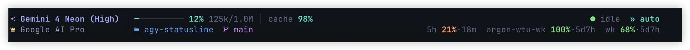

<h1 align="center">agy-statusline</h1>

<p align="center">
  A custom two-line status bar for Antigravity CLI (<code>agy</code>), written in Go:<br>
  zero external dependencies, Catppuccin / Tokyo-Night palette, smooth gradient context bar, and responsive layout.
</p>

<p align="center">
  <a href="https://github.com/jiazixin/agy-statusline/actions/workflows/ci.yml"></a>
  <a href="https://github.com/jiazixin/agy-statusline/releases/latest"></a>
  
  
</p>

<p align="center">
  <a href="README.md">简体中文</a> · <b>English</b>
</p>

---

`agy-statusline` reads the JSON status payload from `stdin` provided by Antigravity CLI and renders an aligned, two-line color status bar to `stdout`. Built solely on the Go standard library as a single static binary, it starts instantly and supports multiple architectures across Linux, macOS, and Windows.

<p align="center">
  
</p>

> Install and enable a Nerd Font in your terminal so the model, plan tier, directory, and Git branch icons render properly.

## Features

- **Aligned two-line responsive layout**: left/right justification based on `terminal_width` with first-column alignment across rows; automatically switches to compact mode below 80 columns (shorter bar, concise labels, secondary fields hidden). Includes zero-allocation ANSI skipping and East Asian / emoji display-width calculation.
- **TrueColor with automatic 256-color fallback**: detects 24-bit color via `COLORTERM` (`truecolor` / `24bit`) and common modern `TERM_PROGRAM` values to render per-cell gradient bars, falling back gracefully to 256-color escapes elsewhere.
- **Context window & prompt cache tracking**: smooth gradient context progress bar (teal→sky normally, yellow→peach at ≥60%, peach→red at ≥80%), percentage, used/max token ratio, and current prompt cache hit rate.
- **Workspace & Git status**: displays the current directory name, Git branch, and dirty indicator (`*`). If the payload omits VCS metadata, it falls back to `git --no-optional-locks status --porcelain=v2 --branch` with a 500ms timeout.
- **Quota & AI credits**: supports `quota.windows`, keyed `quota` buckets, and `rate_limits`, automatically filtering buckets for the active model family with reset countdowns, plus AI credits (`⚡`).
- **Agent state & runtime indicators**: displays agent state (`working` / `thinking` / `tool_use` / `running` / `idle`), cycle mode (`auto` / `accept-edits` / `plan` / `default`), and active subagents, tasks, artifacts, and sandbox badges.
- **Zero-dependency single binary**: pure Go standard library with no third-party dependencies; gracefully falls back to `✦ Antigravity` on malformed JSON input.

## Requirements

| Item | Requirement |
| --- | --- |
| Operating system | Linux, macOS, or Windows |
| Antigravity CLI | `agy` installed with `statusLine` configured in `settings.json` |
| Font (recommended) | Any Nerd Font (for model, plan, folder, and Git glyphs) |
| Terminal colors (recommended) | 24-bit TrueColor terminal (automatically falls back to 256 colors) |
| Git (optional) | Used as a fallback when `vcs` info is absent from the status payload |
| Building from source | Go 1.27 or newer (uses standard library `encoding/json/v2`) |

## Quick start

### 1. Download a prebuilt release

Download the archive for your OS and architecture from [Releases](https://github.com/jiazixin/agy-statusline/releases/latest):

- **Linux / macOS** (`.tar.gz`):

```sh
ver=1.0.0   # replace with the actual version on the Releases page (without the v)
os=linux    # or darwin
arch=amd64  # or arm64, etc.

curl -LO "https://github.com/jiazixin/agy-statusline/releases/download/v${ver}/agy-statusline_${ver}_${os}_${arch}.tar.gz"
curl -LO "https://github.com/jiazixin/agy-statusline/releases/download/v${ver}/checksums.txt"
sha256sum --ignore-missing -c checksums.txt   # on macOS: shasum -a 256 --ignore-missing -c checksums.txt

mkdir -p ~/.local/bin
tar -xzf "agy-statusline_${ver}_${os}_${arch}.tar.gz" -C ~/.local/bin agy-statusline
chmod +x ~/.local/bin/agy-statusline
~/.local/bin/agy-statusline --version
```

> macOS binaries are not notarized. If Gatekeeper blocks a browser download, run `xattr -d com.apple.quarantine ~/.local/bin/agy-statusline`.

- **Windows** (`.zip`):

Download `agy-statusline_<version>_windows_<arch>.zip` (`amd64`, `arm64`, or `386`) from Releases, extract `agy-statusline.exe`, and place it in a directory such as `%USERPROFILE%\.local\bin\agy-statusline.exe` (or any directory on `PATH`).

### 2. Build from source

```sh
git clone https://github.com/jiazixin/agy-statusline.git
cd agy-statusline
CGO_ENABLED=0 go build -trimpath -ldflags="-s -w" -o ~/.local/bin/agy-statusline .
```

### 3. Configure Antigravity CLI

Edit `~/.gemini/antigravity-cli/settings.json` and add or update `statusLine`:

```json
{
  "statusLine": {
    "type": "command",
    "command": "~/.local/bin/agy-statusline"
  }
}
```

On Windows, point `command` to your `agy-statusline.exe` path (or `"agy-statusline.exe"` if it is on `PATH`). Launch or refresh `agy` to see the status bar.

## Layout and environment

### Displayed segments

| Position | Contents |
| --- | --- |
| Row 1, left | Model name & effort level, gradient context window progress bar & token ratio, prompt cache hit rate |
| Row 1, right | Agent state (full mode), cycle mode (`auto` / `accept-edits` / `plan` / `default`) |
| Row 2, left | Plan tier (full mode), workspace directory & Git branch/dirty mark, subagents / tasks / artifacts / sandbox counts |
| Row 2, right | Model-matched quota remaining percentages & reset countdowns, AI credits (`⚡`) |

### CLI flags and environment variables

- `-h` / `--help`: print usage to stdout and exit with status 0.
- `-v` / `--version`: print the embedded binary version and revision (e.g. `agy-statusline v1.0.1 (revision=0123456789ab)`) and exit; for source tarballs without `.git`, pass `-ldflags="-X main.version=v1.0.1"`.
- Unknown arguments print an error to stderr and exit with status 2.

| Variable | Behavior |
| --- | --- |
| `COLORTERM` | Enables 24-bit TrueColor when containing `truecolor` or `24bit` |
| `TERM_PROGRAM` | Auto-enables TrueColor for iTerm2, Ghostty, WezTerm, Warp, VS Code, Kitty, Alacritty, Hyper, Rio, and Tabby |
| `WT_SESSION` | Auto-enables 24-bit TrueColor in Windows Terminal |
| `AGY_STATUS_DEBUG` | When set to `1`, writes the raw `stdin` JSON payload to `agy-statusline-debug.json` in the system temp directory (`/tmp` on Linux, `$TMPDIR` on macOS, `%TEMP%` on Windows) |

## Supported release targets

Every `v*` tag push triggers GitHub Actions to cross-compile all targets below and publish them alongside `checksums.txt`:

| OS | Architectures | Archive format |
| --- | --- | --- |
| Linux | `amd64`, `arm64`, `386`, `armv6`, `armv7`, `loong64`, `mips`, `mipsle`, `mips64`, `mips64le`, `ppc64`, `ppc64le`, `riscv64`, `s390x` | `.tar.gz` |
| macOS (`darwin`) | `amd64`, `arm64` | `.tar.gz` |
| Windows | `amd64`, `arm64`, `386` | `.zip` |

> Linux architectures beyond `amd64` / `arm64` and Windows builds are cross-compiled in GitHub Actions. Please open an issue if you hit a platform-specific problem.

## Local debugging and development

Pipe a sample payload directly into `go run .` to preview the rendered output in your terminal:

```sh
printf '%s\n' '{
  "terminal_width": 110,
  "model": {"id": "gemini-4-neon-high", "display_name": "Gemini 4 Neon", "effort": "high"},
  "context_window": {
    "used_tokens": 42000,
    "context_window_size": 200000,
    "current_usage": {"input_tokens": 12000, "cache_read_input_tokens": 84000, "cache_creation_input_tokens": 4000}
  },
  "agent_state": "working",
  "cycle_mode": "auto",
  "plan_tier": "Ultra",
  "workspace": {"current_dir": "/path/to/agy-statusline"},
  "vcs": {"type": "git", "branch": "main", "dirty": true},
  "quota": {"gemini-5h": {"remaining_fraction": 0.85, "reset_in_seconds": 12900}},
  "ai_credits": 120
}' | go run .
```

Run formatting, static analysis, and race-detector tests locally:

```sh
gofmt -l .
go vet ./...
CGO_ENABLED=1 go test -race -count=1 ./...
```

On pushes to `main` and pull requests, the [CI workflow](.github/workflows/ci.yml) runs `gofmt`, cross-platform `go vet`, race tests, and a GoReleaser multi-target snapshot build.

## Releases

Push a `v*` Git tag (such as `v1.0.0` or `v1.0.0-rc.1`) to trigger the [Release workflow](.github/workflows/release.yml):

```sh
git tag v1.0.0
git push origin v1.0.0
```

The workflow runs `go vet` and `go test`, then invokes GoReleaser with [`.goreleaser.yaml`](.goreleaser.yaml) to build every Linux, macOS, and Windows target, generate SHA-256 checksums (`checksums.txt`), and publish a GitHub Release (tags with pre-release suffixes are marked as pre-releases automatically).

## Project layout

```text
main.go                  Status payload parsing, color rendering, and Git status fallback
main_test.go             Unit tests (display width, context/quota edge cases, payload handling)
go.mod                   Go module definition (zero external dependencies)
.goreleaser.yaml         GoReleaser multi-OS / multi-architecture build and release config
.github/workflows/       GitHub Actions CI and v* tag release workflows
assets/                  README preview screenshot
README.md                Simplified Chinese README
README.en.md             English README
```
